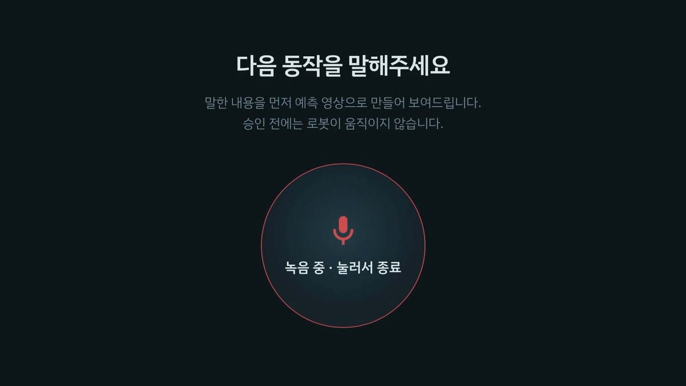

# camera_client — Orbbec Gemini E 촬영 클라이언트

월드 모델이 미래를 예측하려면 **명령 시점의 현재 수술 장면**이 필요합니다. camera_client는 Gemini E 카메라가 연결된 노트북에서 동작하며, 집도의가 웹 콘솔에서 녹음을 시작하는 순간 수술대를 촬영해 서버로 올립니다. 이 사진이 Cosmos 예측 영상의 입력 프레임이 되고, 녹음이 끝날 때까지 장면을 함께 녹화합니다.



## 동작 흐름

```
웹 콘솔 녹음 시작 ─▶ web_server: capture_command.json = {job_id, action: start, status: pending}
                                   ▲ 0.5초마다 GET /capture/pending
capture_client ─ ACK(POST /capture/ack) ─▶ 워밍업 5프레임 버림 → 첫 프레임 PNG 업로드(POST /capture/upload) → 녹화 시작
웹 콘솔 녹음 종료 ─▶ action: stop ─▶ capture_client 녹화 종료 (recordings/{job_id}.mp4)
```

카메라 노트북에는 외부에서 접속할 수 있는 주소가 없기 때문에, 서버가 촬영 요청을 게시하고 노트북이 0.5초마다 이를 조회해 가는 방식으로 설계했습니다.

## 핵심 설계

- **중복 촬영 방지**: 서버가 ACK를 받아들인 경우에만 촬영합니다. 같은 요청을 두 번 가져가도 한 번만 실행됩니다.
- **안정된 첫 프레임**: 카메라를 켠 직후 노출이 맞지 않은 프레임 5장을 버리고, 그다음 프레임을 예측 입력으로 올립니다.
- **녹화 연속성**: 첫 프레임 업로드가 네트워크 문제로 실패해도 녹화는 계속합니다. 이전 녹화의 STOP을 받지 못한 상태에서 새 START가 오면 이전 녹화를 자동으로 마무리하고 새로 시작합니다.
- **학습 데이터 촬영과 분리**: 월드 모델 학습용 영상은 [`../world_model/tools/record_take.py`](../world_model/tools/record_take.py)로 따로 촬영합니다. OpenCV DSHOW로 열면 화각이 좁아지기 때문에, 학습 촬영에는 ffmpeg dshow 입력으로 1920×1080 원본 화각을 그대로 기록합니다.

## 파일 구성

| 경로 | 역할 |
|---|---|
| `capture_client.py` | 촬영 요청 조회, ACK, 첫 프레임 업로드, 녹화 시작·종료 |
| `requirements.txt` | 필요한 패키지 (opencv-python, requests) |

<details>
<summary><b>▶ 실행 방법</b></summary>

```bash
pip install -r requirements.txt
python capture_client.py find      # 카메라 번호 확인 (Windows DSHOW)
python capture_client.py
```

| 환경변수 | 기본값 | 설명 |
|---|---|---|
| `HC122_SERVER_URL` | `http://127.0.0.1:5050` | 웹 콘솔 주소 |
| `HC122_CAMERA_INDEX` | 1 | Gemini E RGB 장치 번호 |

</details>
