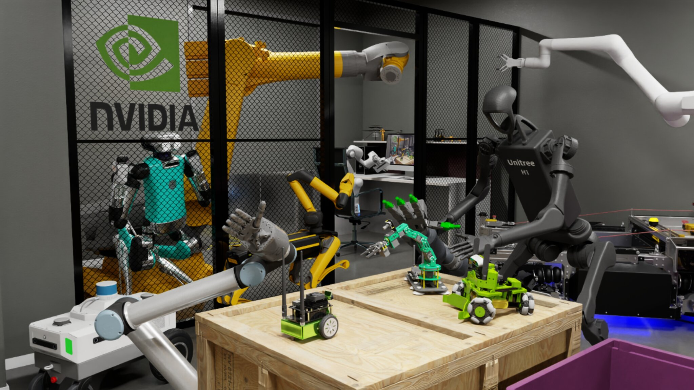

# rl_policy — 절개·개복 강화학습 정책 (Isaac Lab + PPO)



> 기반 플랫폼: [NVIDIA Isaac Sim](https://github.com/isaac-sim/IsaacSim) 5.1.0 · [Isaac Lab](https://github.com/isaac-sim/IsaacLab) 2.3.2 · [skrl](https://github.com/Toni-SM/skrl) 2.1.0
> Isaac Sim 원문 소개는 [`ISAAC_SIM_README.md`](ISAAC_SIM_README.md)에 보관했습니다. (이미지 출처: isaac-sim/IsaacSim, Apache-2.0)

DOFBOT 양팔이 수행하는 **절개**와 **개복**을 GPU 병렬 시뮬레이션에서 PPO로 학습한 정책입니다.
절개 정책은 오른팔로 매번 달라지는 절개선을 따라 칼날을 긋고, 개복 정책은 양팔로 절개선을 벌립니다.
학습한 정책은 시뮬레이션에서 실행해 관절 궤적으로 만들고, 안전 검사를 통과한 궤적만 실제 로봇으로 보냅니다.
비전(`vision`)이 찾은 절개선을 입력으로 받아 제어(`jetson_control`)가 실행할 궤적을 돌려주며, 입출력 규격은 [`INTERFACE.md`](INTERFACE.md)에 정리했습니다.

## 흐름

```
[GPU 서버 · Isaac Lab]
  과제 정의(task/) ──PPO 학습(4096 환경)──▶ 정책 ──평가──▶ results/
                                            │
                                            ▼
                          시뮬레이션에서 정책 실행 → 관절 궤적 → 안전 검사
                          · 절개: 절개선마다 궤적 생성
                          · 개복: 절개선 위치 1,377곳의 궤적을 미리 생성 → weights/opening_library.npz

[Jetson · Isaac Lab 없이 numpy만]
  절개선 (Start/End, mm) ──▶ deploy/ ──▶ 서보 각도 궤적 + 서보 범위·변화량 검사 ──▶ I2C로 양팔 구동
```

로봇에서 정책을 매 주기 직접 돌리지 않는 이유는, 두 정책 모두 칼끝 위치나 경로 진행 거리처럼 시뮬레이션이 계산해 주는 값을 관측으로 쓰기 때문입니다.
그래서 정책은 시뮬레이션에서 끝까지 실행하고, 로봇은 그 결과 궤적을 따라갑니다.

## 정책 구성

| | 절개 `Dofbot-Incision-Direct-v3` | 개복 `Dofbot-Opening-Direct-v0` |
|---|---|---|
| 제어 대상 | 오른팔 (I2C 버스 8) | 양팔 (버스 8 · 버스 1) |
| 관측 / 행동 | 29 / 5 (관절 1~5 위치 목표 변화량) | 43 / 8 (팔마다 관절 1~4 위치 목표 변화량) |
| 신경망 | 512·512·256·128 (ELU), 관측 정규화 | 같은 구조 |
| 제어 주기 | 60 Hz (물리 120 Hz) | 60 Hz |
| 매 에피소드 무작위화 | 절개선 길이 40~70 mm, 방향 60~105°, 중심 x 135~235 mm · y ±80 mm | 절개선 위치 x ±10 mm, y ±20 mm, 회전 ±8° |
| 기준 동작 | 없음 (보상만으로 학습) | 사람이 직접 기록한 개복 동작(`motions/opening_dual.json`)을 경로로 사용 |

## 과제 설계

### 절개 — "찍기"가 아니라 "긋기"를 학습

칼끝이 아래 네 조건을 **동시에** 만족하는 동안만 절개로 인정합니다 (`dofbot_incision_env_v3.py` 535~567행).

| 조건 | 기준 |
|---|---|
| 칼끝과 절개선 사이 수직 거리 | 4 mm 미만 |
| 깊이 오차 (목표: 피부면 아래 5 mm) | 3 mm 미만 |
| 공구가 수직으로 선 정도 | cos > 0.6 |
| 칼날 방향과 절개선 방향 | \|cos\| > 0.90 |

절개 진행 거리는 **직전 스텝에도 절개 중이었고, 이미 그은 지점에서 이어질 때만** 늘어납니다.
처음 학습할 때는 절개선 위의 점을 하나씩 찍고 떼는 동작이 나왔는데, 이 규칙으로 칼을 떼면 진행이 멈추고 감점되도록 바꿔 접촉을 유지한 채 긋는 동작을 학습하게 했습니다.

| 주요 보상 | 가중치 |
|---|---|
| 절개 진행 (늘어난 거리 / 선 길이) | 10000 |
| 완주 보너스 | 1000 |
| 긋던 중 칼을 뗌 | −200 |
| 칼끝 접근 · 깊이 · 수직 자세 · 칼날 정렬 (형상 보상) | 0.5 ~ 1.5 |
| 손끝·링크가 피부면이나 패치 바닥 아래로 침범 | −150 / m |

전체 항목과 식은 `dofbot_incision_env_cfg_v3.py` 403~585행에 있습니다.

### 개복 — 양팔 동기 경로 추종

사람이 기록한 개복 동작(양팔이 절개선 위로 모여 공구를 넣고 각자 바깥쪽으로 벌림)을 관절 공간에서 보간해 끝점 경로를 만들고, 매 에피소드 절개선 위치를 옮기면서 경로도 함께 옮깁니다.
두 팔의 진행률 차이가 10% 이상 벌어지면 앞선 팔의 진행이 멈추도록 해 양팔이 같은 속도로 움직이게 했습니다.

| 주요 보상 | 가중치 |
|---|---|
| 경로 진행 (접근 1 : 삽입 2 : 벌림 4 가중) | 10000 |
| 벌림 상태 60 스텝 유지 시 완료 보너스 | 1000 |
| 삽입·벌림 구간에서 경로 이탈 | −200 |
| 양팔 진행률 차이 | −1 |

전체 항목은 `dofbot_opening_env_cfg.py` 117~146행에 있습니다.

## 결과 (시뮬레이션, 2026-10-12 재실행)

| 항목 | 결과 | 근거 |
|---|---|---|
| 절개 완주율 | **81% (52 / 64 환경)**, 그은 비율 평균 87% · 중앙값 100% | [`results/eval_incision_20261012.md`](results/eval_incision_20261012.md) |
| 절개 방향별 완주 | 60~75° 18/20 · 75~90° 16/20 · 90~105° 15/24 | 같음 |
| 개복 완료율 | **100% (256 / 256 환경)**, 벌림 폭 135 mm (기록 동작 133 mm) | [`results/eval_opening_20261012.md`](results/eval_opening_20261012.md) |
| 개복 궤적 묶음 | 1,377곳 중 1,376곳 안전 검사 통과, 양팔 최소 간격 68 mm | [`results/opening_library_20261009.md`](results/opening_library_20261009.md) |

평가 절개선은 학습과 같은 범위에서 다른 시드로 무작위 생성했습니다. 시뮬레이션에는 피부 변형 모델이 없고 칼끝은 계산된 점입니다.

## 실제 로봇 적용 (Sim-to-Real)

| 단계 | 내용 |
|---|---|
| 관절 보정 | 서보 각도 ↔ 시뮬레이션 관절각 변환 (관절 1~4 방향 반전, 손목 롤 +135° 오프셋을 실기에서 측정) — `deploy/servo.py` |
| 서보 끝단 여유 | 관절이 가동 범위 끝에 붙지 않도록 4° 안쪽으로 제한 — `scripts/apply_servo_margin.py` |
| 시뮬레이션 안전 검사 | 칼끝·링크가 수술대 아래로 내려가는지, 관절이 끝단에 붙는지, 양팔 간격 60 mm 이상인지 — `scripts/check_trajectory_safety.py` |
| Jetson 안전 검사 | 서보 범위, 명령 간 변화 25° 이하. 실패하면 궤적을 내보내지 않음 — `deploy/safety.py` |

| 동작 | 실기 상태 |
|---|---|
| 개복 (양팔) | 개복 정책 궤적을 실제 양팔로 구동, 정상 동작 확인 (2026-10-08, 기록 위치의 절개선) |
| 절개 (오른팔) | 절개 정책 궤적을 칼날 없이 구동해 손목 롤 오프셋을 찾아 반영 (2026-08-31). 칼날 장착 구동은 높이 확인 후 진행 예정 |
| deploy dry-run | 개복 2건 통과 · 범위 밖 1건 거부, 절개 1건 통과 (모터 미구동) — [`results/dryrun_20261012.md`](results/dryrun_20261012.md) |

## 폴더

| 경로 | 내용 |
|---|---|
| [`INTERFACE.md`](INTERFACE.md) | 비전·제어와의 입출력 규격 (좌표계, 관측·행동, 보정, deploy API, 궤적 형식) |
| `task/dofbot/` | Isaac Lab 과제 패키지: 절개·개복 환경, skrl PPO 설정(`agents/*.yaml`) |
| `scripts/` | 학습(`train.py`), 재생(`play.py`), 평가(`eval_*.py`), 궤적 추출·안전 검사, 영상 렌더링 |
| `deploy/` | Jetson용 궤적 생성·검사·dry-run (numpy만 필요) |
| `deploy/agx/` | Jetson에서 Arm_Lib로 궤적을 재생하는 스크립트, 오른팔 관절 보정값 |
| `motions/` | 사람이 직접 기록한 절개·개복 동작 JSON, 개복 도달 범위 맵 |
| `weights/` | 정책 신경망과 관측 정규화 값만 추린 `.npz`, 개복 궤적 묶음 |
| `results/` | 평가·dry-run 기록 |

## 실행

**학습·평가 (GPU 서버, Isaac Lab 설치 환경, 이 폴더에서)**

```bash
export PYTHONPATH=$PWD/task/dofbot:$PYTHONPATH
export DOFBOT_ROBOT_USD=<DOFBOT 로봇 USD 경로>     # 로봇 모델은 저장소에 포함하지 않음

python scripts/train.py --task=Dofbot-Incision-Direct-v3 --num_envs=4096 --headless
python scripts/eval_incision.py <checkpoint.pt> --envs 64

# 절개선 하나에 대한 궤적 생성 → 끝단 여유 → 안전 검사 ("재생 가능" 판정만 로봇으로)
python scripts/export_trajectory.py <checkpoint.pt> --heading 90 --length 0.05 --cx 0.17 --cy 0.0 --out traj.npz
python scripts/apply_servo_margin.py traj.npz --margin-deg 4 --out traj_margin.npz
python scripts/check_trajectory_safety.py traj_margin.npz
```

**Jetson (Isaac Lab 불필요, `src/`에서)**

```bash
pip install -r rl_policy/deploy/requirements.txt            # numpy
python -m rl_policy.deploy.dry_run opening --line 154 44 168 -29 --out out.json --csv-out out.csv
python rl_policy/deploy/agx/replay_opening_on_agx.py out.csv --dry-run    # 각도 확인
python rl_policy/deploy/agx/replay_opening_on_agx.py out.csv              # 실제 구동
```

```python
from rl_policy.deploy import plan_opening, PlacementOutOfRange, TrajectorySafetyError

traj = plan_opening((159, 56), (176, -16), reference_ends_mm=((154, 44), (168, -29)))
# 범위를 벗어나거나 검사에 실패하면 예외가 발생하고 궤적은 반환되지 않습니다.
```

학습에 쓴 원본 체크포인트(`.pt`)와 로봇 USD 모델은 용량 문제로 저장소에 넣지 않았습니다.

## 시연과의 차이

발표 시연의 로봇 동작은 `motions/`의 기록 동작(사람이 로봇을 움직여 저장한 궤적)을 재생했습니다.
이 폴더의 코드는 정책이 만든 궤적을 생성·검사·재생하는 경로이며, 위 "실기 상태"는 이 경로로 구동한 결과입니다.

## 한계

- 절개는 절개선마다 GPU 서버에서 궤적을 생성해야 합니다. Jetson에서 바로 생성되는 것은 개복뿐입니다.
- 기록 동작과 절개 과제 사이에 칼끝 높이 차이(약 30 mm)가 있어, 칼날 장착 구동 전에 실측 보정이 필요합니다.
- 개복은 기록한 절개선 위치 기준 x ±10 mm, y ±20 mm, 회전 ±8° 안에서만 동작하고, 벗어나면 거부합니다.
- 왼팔 관절 방향은 오른팔 측정값을 그대로 사용했고, 실기 구동 결과는 별도 로그 파일로 남기지 않았습니다.
