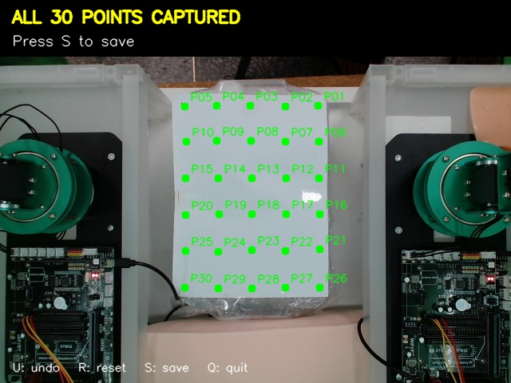

# C920 비전·30점 캘리브레이션

팀에서 사용한 C920 촬영, HSV 절개선 Pixel Start/End 검출, 30점 Pixel–World Homography, World–양팔 베이스 좌표 변환 코드와 제공된 측정 자료다. 이 문서에 실행 방법과 검증 범위를 기록했다.

검출 프로그램과 좌표 변환 프로그램은 **별도로 실행**한다. 검출창에서 `s`로 Pixel 좌표를 출력하고, 그 값을 좌표 변환 CLI에 입력한다. 검출부터 로봇 좌표까지 자동 연결하는 함수, 제어 실행기, 정책 연결, 로봇 동작 재생은 포함하지 않는다.

## 파일 구성과 역할

아래 표는 `src/vision/` 기준 경로다. 원래 `surgical_pipeline`을 기준으로 한 `parents[2]` 경로와 `common.coordinates` import를 유지했다.

| 경로 | 역할 |
|---|---|
| `surgical_pipeline/vision/detect_incision_c920.py` | 고정 ROI 안에서 HSV 마스크·contour 조건으로 절개선 검출, 화면 아래 START·위 END Pixel 출력 |
| `surgical_pipeline/vision/detect_incision_c920_record.py` | 검출 화면과 표시를 MP4로 녹화 |
| `surgical_pipeline/vision/webcam_record.py` | V4L2·MJPG로 C920 원본 화면을 AVI로 녹화 |
| `surgical_pipeline/vision/calibration/collect_pixel_world_calibration_30.py` | 30점 순서대로 클릭, H 추정, 대응점·오차·스냅샷 저장 |
| `surgical_pipeline/vision/calibration/pixel_to_world_30.py` | Pixel → World CLI 및 카메라 클릭 확인 |
| `surgical_pipeline/vision/calibration/pixel_to_dual_robot_base_30.py` | Pixel/World/선분 → 좌·우 베이스 출력, 정해진 World 점 확인 |
| `surgical_pipeline/common/coordinates/coordinate_transform.py` | H·베이스 JSON 로드, 점·벡터 좌표 변환 함수 |
| `surgical_pipeline/common/calibration/calibrate_base_yaw.py` | **실제 모터를 움직여** 베이스 yaw 방향을 사람이 판정하는 측정 스크립트 |
| `surgical_pipeline/config/calibration/face_to_face_20260821/` | 제공된 JSON 3개와 30점 스냅샷 1개 |
| `results/verify_calibration.py` | 이번에 작성한 장비 없는 문법·수치·좌표·CLI·파일 검사 |
| `results/calib_20261015.json` | 재계산 수치, 30점별 잔차, 검증 항목, 원자료 SHA-256 |
| `results/verification_20261015.md` | 검증 조건과 미검증 범위 |

검출·좌표 계산 로직은 보존했다. 변경은 개인 영상 경로 제거, 저장 디렉터리 설정화, 외부 캘리브레이션 디렉터리 사용 시 출처를 파일명으로 기록하는 경로 처리뿐이다. 제공된 JSON·JPG는 원본 바이트 그대로다.

## 설치와 실행 위치

저장소 루트에서 아래 디렉터리로 이동한다. Python 3, NumPy, GUI 기능이 있는 OpenCV가 필요하다. 원본 장비의 JetPack·Python·라이브러리 버전 기록은 제공되지 않았다. 이번 파일 검증 환경은 [검증 기록](results/verification_20261015.md)에 별도로 적었다.

```bash
cd src/vision/surgical_pipeline
python3 -m pip install numpy opencv-python
```

장비에 이미 설치된 OpenCV를 사용한다면 이를 덮어 설치하기 전에 환경을 확인한다. `webcam_record.py`의 `CAP_V4L2`는 Linux용이다. yaw 측정에만 장비의 `Arm_Lib`와 `smbus`, I2C 접근 권한이 추가로 필요하다. 파일 수치 검증에는 이 두 라이브러리가 필요 없다.

### 장비에 접근하지 않는 명령

위 실행 위치에서 복사해 실행한다.

```bash
python3 -B vision/calibration/pixel_to_world_30.py pixel 398 132
python3 -B vision/calibration/pixel_to_dual_robot_base_30.py verify
python3 -B vision/calibration/pixel_to_dual_robot_base_30.py pixel 398 132
python3 -B vision/calibration/pixel_to_dual_robot_base_30.py world 70 95 0
python3 -B vision/calibration/pixel_to_dual_robot_base_30.py line 315 313 315 223
python3 -B ../results/verify_calibration.py
```

`line`의 좌표는 제공된 격자 점을 사용한 계산 예시다. 실제 검출한 절개선이나 로봇에 보낼 명령이 아니다. `pixel U V [Z]`의 Z 기본값은 World 0 mm이며, 선택 Z는 사용자가 지정하는 높이다. H가 깊이를 측정하는 것은 아니다.

### 카메라가 필요한 명령 — 이번 검증에서는 실행하지 않음

```bash
python3 vision/detect_incision_c920.py
python3 vision/detect_incision_c920_record.py
python3 vision/webcam_record.py
python3 vision/calibration/pixel_to_world_30.py test
python3 vision/calibration/pixel_to_dual_robot_base_30.py test
```

검출기는 `s`로 마지막 START/END를 출력하고 `q`로 종료한다. 녹화 스크립트는 실행 시 녹화를 시작하고 `q`로 저장·종료한다. `webcam_record.py`는 최상위 코드에서 즉시 카메라를 열기 때문에 다른 코드에서 import하지 않는다.

| 설정 | 위치와 기본값 |
|---|---|
| 카메라 | 각 스크립트 상단 `CAMERA_INDEX=0` |
| 해상도 | `WIDTH/HEIGHT` 또는 `FRAME_WIDTH/FRAME_HEIGHT`: 640×480 |
| 녹화 FPS | 두 녹화 스크립트 `FPS=30`; 실제 카메라 지원 여부는 미검증 |
| ROI | 두 검출 스크립트 상단: `x=[250,385)`, `y=[170,355)` |
| HSV | 두 검출 스크립트 상단: `H1_MAX=9`, `H2_MIN=136`, `S_MIN=25`, `V_MIN=61` |
| 실시간 HSV | `HSV CONTROL` 창의 트랙바; 변경값을 별도 설정 파일로 저장하지 않음 |
| contour | `MIN_AREA=8`, `MIN_HEIGHT=12`, `MAX_WIDTH=35`, `MIN_VERTICAL_RATIO=1.5` |
| smoothing | `ALPHA=0.30` (비녹화 검출기는 `main()` 내부) |

HSV의 H는 OpenCV의 0–179 범위이며 `[0,H1_MAX]`와 `[H2_MIN,179]` 마스크를 합친다. 2×2 opening, 3×3 closing 후 세로로 긴 contour를 우선한다. 두 끝점의 X는 contour bounding box 중심으로 같게 고정된다.

### 저장 위치

| 환경변수 | 기본값과 적용 대상 |
|---|---|
| `HC122_VIDEO_DIR` | 사용자 홈의 `Videos`; 두 녹화 프로그램 |
| `HC122_CALIB_DIR` | `surgical_pipeline/config/calibration/face_to_face_20260821`; 수집·yaw 저장·좌표 로더 |

환경변수는 프로그램 실행 전에 설정한다. 상대 경로는 현재 작업 디렉터리 기준이다. 새 측정은 별도 디렉터리에 저장해 전달받은 측정 자료를 보존한다. 수집·yaw 프로그램은 동일 파일명이 있으면 덮어쓴다. 영상은 커밋 대상이 아니다.

## 좌표계와 변환

| 좌표계 | 원점 | +X / +Y / +Z | 단위 |
|---|---|---|---|
| Pixel `(u,v)` | 영상 왼쪽 위 | u 오른쪽 / v 아래쪽 / Z 없음 | px |
| World | P01 `(0,0,0)` | P01→P05 / P01→P26 / 피부 평면 위쪽 | mm |
| 좌 Base | World `(-124,86,27)` | World −Y / World +X / World +Z | mm |
| 우 Base | World `(254,86,27)` | World +Y / World −X / World +Z | mm |

이는 제공된 `robot_base_calibration_face_to_face.json`의 정의다. 좌 yaw −90°, 우 yaw +90°, 좌 I2C 버스 1·우 버스 8, 주소는 둘 다 `0x15`다. 축을 정책 규약에 맞추기 위해 임의로 회전하지 않았다. 정책 연결 시에는 담당자가 이 좌표 정의와 입력 규약을 별도로 확인해야 한다.

동차 좌표를 사용한다.

```text
[a,b,c]^T = H [u,v,1]^T
World = [a/c, b/c, world_z_mm]
Base = Rz(-yaw) (World - base_origin_world_mm)
Base_vector = Rz(-yaw) World_vector
```

점에는 원점 이동이 적용되고, 방향 벡터에는 회전만 적용된다. 피부면 World Z=0이면 베이스 Z는 −27 mm다.

저장된 H:

```text
[-0.848260764540,  0.008093247409,  336.576406623147]
[ 0.004418032996,  0.854165097326, -114.184141138325]
[ 0.000017640143,  0.000054535517,    1.000000000000]
```

`pixel 398 132`의 실제 CLI 출력 예시:

```text
Pixel: (398.0,132.0)
World: (0.036, 0.319, 0.000) mm
Left Base: (85.681, 124.036, -27.000) mm
Right Base: (-85.681, 253.964, -27.000) mm
```

World `(70,95,0)`은 좌 Base `(-9,194,-27)`, 우 Base `(9,184,-27)`이다. 검출 프로그램은 이 변환을 호출하지 않고 Pixel 두 점만 출력한다.

## 30점 측정과 재캘리브레이션

1. 카메라·작업 평면·로봇 베이스를 고정하고 640×480 영상에서 격자 30점이 보이게 한다.
2. 격자는 5열×6행, X 간격 35 mm, Y 간격 38 mm, 전체 140×190 mm다. P01이 World 원점이고 한 행에 P01→P05, 다음 행에 P06→P10 순서다. 제공 스냅샷에서는 World +X가 화면 왼쪽으로 향한다.
3. 아래 명령을 실행하고 P01부터 P30까지 순서대로 클릭한다. `u`: 한 점 취소, `r`: 전체 초기화, `q`: 종료.
4. 30점이 모두 모이면 `s`로 저장한다. `cv2.findHomography(..., method=0)`로 전체 점을 사용해 H를 구하며, 각 점의 XY 잔차와 요약값·스냅샷을 저장한다.
5. 저장 결과를 확인하고 파일 검증을 실행한다. 새 데이터의 요약 키는 수집 코드가 쓰는 `mean_error_mm`, `rmse_mm`, `max_error_mm`다. 이번 검증 스크립트는 전달된 자료의 `_recomputed` 출처 필드를 검사하도록 작성되어 있다.

```bash
# Linux 예시: 새 측정 파일을 분리해 저장
export HC122_CALIB_DIR="$HOME/hc122-calibration-new"
python3 vision/calibration/collect_pixel_world_calibration_30.py
```

카메라 위치·각도·해상도·크롭·렌즈 설정, 작업 평면의 높이·기울기·격자 위치가 바뀌면 H를 다시 측정한다. 베이스 위치나 방향이 바뀌면 원점·yaw도 다시 측정한다. 조명 변화는 HSV·ROI와 검출 상태를 다시 확인할 조건이다. 새 데이터에 대한 독립 확인점은 H 적합에 사용한 30점과 별도로 측정하고 기록해야 한다.



## 데이터 출처와 이번 검증

제공된 JSON 3개와 스냅샷은 `2026-08-21` 측정 자료다. H JSON의 `note`에는 당시 보고된 30개 Pixel/World 대응점으로 재계산한 자료라는 출처가 있으며 이를 그대로 보존했다. 점 JSON의 `validation_from_terminal`도 원자료 메타데이터로 보존한다. 그 안의 독립 중간점 확인 문구에는 별도의 점 목록·측정 결과가 제공되지 않았으므로 이번 검증의 근거로 사용하지 않는다.

2026-10-15, 제공된 H에 30개 Pixel 점을 float64 동차 좌표로 투영하고 대응 World XY와의 유클리드 거리를 계산했다.

| 항목 | 이번 파일 기반 재계산 결과 |
|---|---|
| 점 개수 | 30 |
| 평균 잔차 | 0.778569806 mm |
| RMSE | 0.900923841 mm |
| 최대 잔차 | 1.981541886 mm (P09) |

이는 **H 적합에 사용한 동일 30점의 평면 잔차**다. 독립 검증 정확도, 3D 복원 정확도, 로봇 칼끝 정확도를 뜻하지 않는다. 좌표 함수의 OpenCV 입력은 원본대로 float32이며 검증 시 float64 계산과 0.00002 mm 허용 오차로 확인했다.

검증 통과: Python 9개 문법, 30점·격자·H·저장된 점별 잔차와 재계산 요약값, 좌·우 원점과 회전, 30점 왕복 변환, 장비 없는 CLI 5종, JPG 디코딩·해상도, 민감정보 패턴·파일 크기 검사. 카메라·모터 접근은 하지 않았다. [기계 판독 결과](results/calib_20261015.json)와 [검증 설명](results/verification_20261015.md)을 참고한다.

## yaw 측정 스크립트

`common/calibration/calibrate_base_yaw.py`는 Arm_Lib·smbus로 실제 로봇에 연결해 STANDBY, 방향 확인 자세, J1 90→105° 자세로 이동한다. 사람이 World 방향과 위에서 본 CCW 회전을 확인하고 베이스 JSON에 저장한다. 종료 처리에서도 STANDBY 이동을 시도한다. 원점은 `BASES` 상수에 들어 있는 실측값이며 이 스크립트가 자동 측정하지 않는다.

아래는 담당자가 칼날 제거·주변 공간·전원 차단 수단·버스 연결을 확인한 뒤 수동으로 사용하는 명령이다. **이번에는 실행하거나 import하지 않았다.**

```bash
sudo -E python3 common/calibration/calibrate_base_yaw.py left
sudo -E python3 common/calibration/calibrate_base_yaw.py right
# both 인자도 지원하며 두 팔을 순서대로 측정한다.
```

## 한계와 미검증 사항

- HSV는 조명·색·그림자·반사 영향을 받는다. 고정 ROI 밖의 절개선과 폭·세로 비율 조건에 맞지 않는 선은 검출하지 못할 수 있다.
- 끝점 X를 같은 중심값으로 만들기 때문에 기울어진 선의 실제 양 끝점을 그대로 복원하지 않는다. smoothing은 과거 검출값의 영향을 받는다.
- 검출 실패 프레임에서 `last_start/last_end`를 비우지 않는 원본 구조라 `s`가 이전 성공 좌표를 출력할 수 있다. 현재 화면 상태와 함께 확인해야 한다.
- H는 기준 평면에만 유효하다. 비평면 피부·높이 변화·렌즈 왜곡을 별도 모델링하지 않는다. 자동 보정이나 외삽 범위 검사는 없다.
- 카메라 캡처·HSV 검출 성능·녹화 코덱·실제 FPS, yaw 모터 측정, 베이스 실측, 독립 점 검증, 로봇 칼끝 정확도는 이번에 검증하지 않았다.
- 전달된 파일에 제어·정책 자동 연결은 없다. 가이드의 향후 연결 요구사항을 구현 완료로 기록하지 않는다. 실제 main에는 가이드에서 언급한 `src/rl_policy/INTERFACE.md`가 없어 해당 파일을 통한 호환성 확인도 하지 않았다.

## 루트 README 발췌 후보

핵심 함수는 `src/vision/surgical_pipeline/common/coordinates/coordinate_transform.py`의 `pixel_to_world()`, `world_to_robot()`, `pixel_to_dual_robot()`이다. 동차 좌표 정규화와 yaw 역회전·원점 이동을 발췌할 수 있다. 루트 README는 이번 변경에서 수정하지 않았다.
